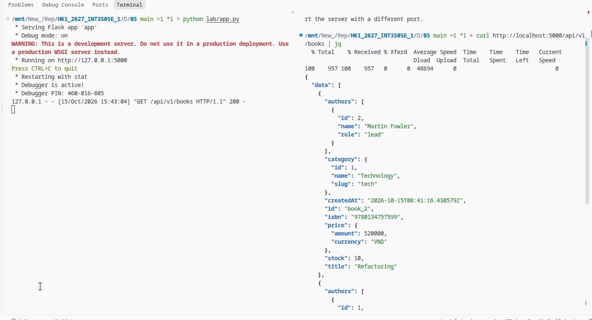
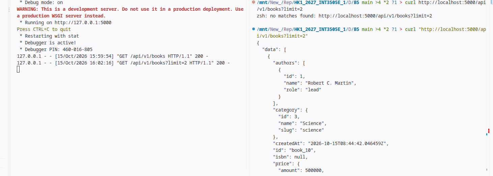
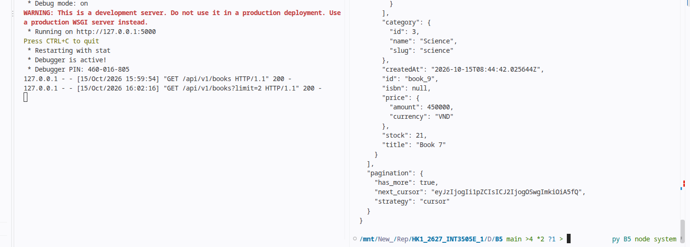
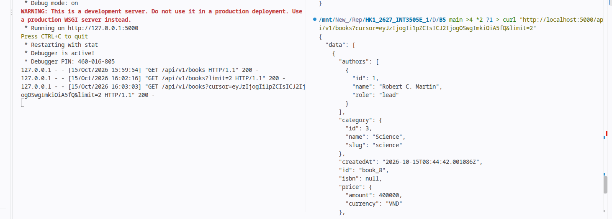
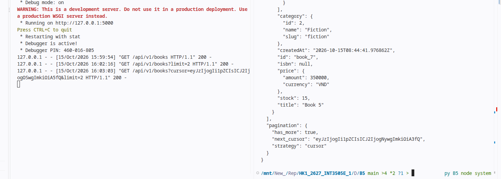
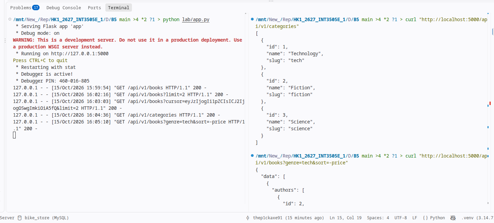
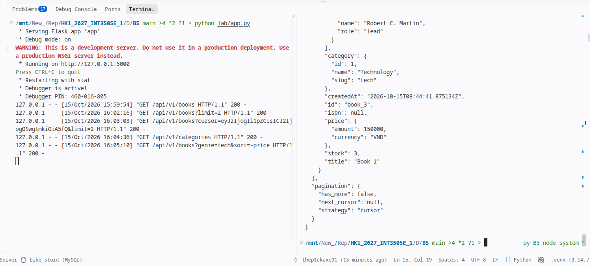

# Lab 1

# Lab 2

## Basic pagination

## Cursor based

## Sort

# Bài tập về nhà 1 — Library Domain (Thư viện)

## Domain: Hệ thống quản lý thư viện

### Entities & Relationships

| Entity | Fields chính | Quan hệ |
|---|---|---|
| **Book** | title, isbn, published_year, description, total_copies | N:1 Category, N:M Author, 1:N BookCopy, 1:N Review |
| **Author** | name, bio | N:M Book |
| **Category** | name, slug | 1:N Book |
| **Member** | email, display_name, membership_type | 1:N Loan, 1:N Review |
| **BookCopy** | barcode, status (available/loaned/damaged) | N:1 Book, 1:N Loan |
| **Loan** | loan_date, due_date, return_date, status | N:1 BookCopy, N:1 Member |
| **Review** | rating (1-5), comment | N:1 Book, N:1 Member |

### Relationship Summary

- **Book ↔ Author** (N:M): Junction table `book_authors` with `role` metadata (lead, co, translator)
- **Book → Category** (N:1): Mỗi sách thuộc 1 thể loại
- **Book → BookCopy** (1:N): Mỗi sách có nhiều bản copy vật lý (strong containment)
- **BookCopy → Loan** (1:N): Mỗi bản copy có lịch sử mượn trả
- **Member → Loan** (1:N): Mỗi thành viên có nhiều lượt mượn
- **Member → Review** (1:N): Mỗi thành viên đánh giá nhiều sách
- **Book → Review** (1:N): Mỗi sách có nhiều đánh giá (strong containment — review mất khi book xoá)

---

## ERD

<!-- Paste your ERD screenshot here -->

---

## URL List — 18 Endpoints

| # | Method | URL | Mô tả |
|---|---|---|---|
| 1 | `GET` | `/api/v1/books` | List books (pagination, filter, sort) |
| 2 | `POST` | `/api/v1/books` | Create book |
| 3 | `GET` | `/api/v1/books/{id}` | Get book detail |
| 4 | `PUT` | `/api/v1/books/{id}` | Update book |
| 5 | `DELETE` | `/api/v1/books/{id}` | Delete book |
| 6 | `GET` | `/api/v1/books/{id}/authors` | List authors of book (N:M) |
| 7 | `POST` | `/api/v1/books/{id}/authors` | Add author to book |
| 8 | `DELETE` | `/api/v1/books/{id}/authors/{author_id}` | Remove author from book |
| 9 | `GET` | `/api/v1/books/{id}/copies` | List copies of book (1:N sub-resource) |
| 10 | `POST` | `/api/v1/books/{id}/copies` | Add copy to book |
| 11 | `GET` | `/api/v1/books/{id}/reviews` | List reviews of book |
| 12 | `POST` | `/api/v1/books/{id}/reviews` | Create review for book |
| 13 | `GET` | `/api/v1/authors` | List authors |
| 14 | `POST` | `/api/v1/authors` | Create author |
| 15 | `GET` | `/api/v1/categories` | List categories |
| 16 | `POST` | `/api/v1/categories` | Create category |
| 17 | `GET` | `/api/v1/members` | List members |
| 18 | `POST` | `/api/v1/members` | Create member |
| 19 | `GET` | `/api/v1/loans` | List loans (filter by member, status) |
| 20 | `POST` | `/api/v1/loans` | Create loan (borrow a copy) |
| 21 | `PUT` | `/api/v1/loans/{id}/return` | Return a loan |

### Query Params cho `GET /books`

| Param | Ví dụ | Mô tả |
|---|---|---|
| `strategy` | `cursor` / `offset` | Pagination strategy |
| `sort` | `-published_year,title` | Multi-key sort (whitelist) |
| `category` | `tech` | Filter by category slug |
| `limit` | `20` | Items per page (max 100) |
| `cursor` | `eyJ...` | Cursor token (cursor strategy) |
| `offset` | `0` | Offset (offset strategy) |

### Query Params cho `GET /loans`

| Param | Ví dụ | Mô tả |
|---|---|---|
| `member_id` | `1` | Filter by member |
| `status` | `active` / `returned` / `overdue` | Filter by loan status |
| `sort` | `-loan_date` | Sort by loan date |